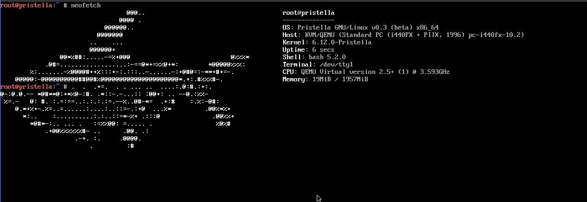

# Pristella
GNU/Linux based Operating System

Beta released!
you can compile utils in QEMU, but don't network.

new
+optimization
+ability to compile
+drivers

CPU determined without any problems

OS used: glibc, coreutils, bash, sed and other GNU utils
QEMU run with ovmf (UEFI), dont BIOS

if you want starting OS in real pc figure it out yourselves 